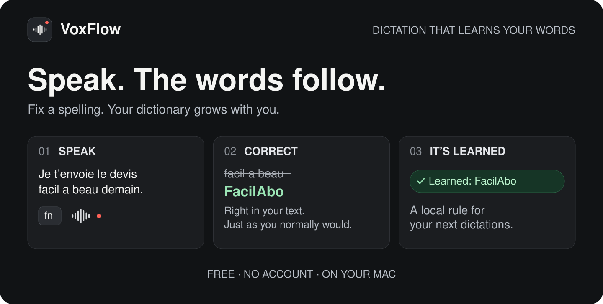
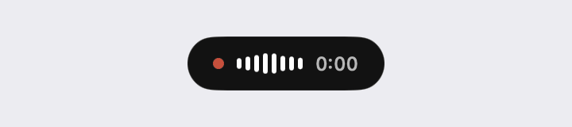
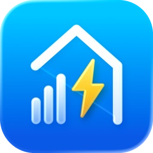
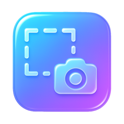

<div align="center">

[Français](README.md) · **English**

</div>

<picture>
  <source media="(max-width: 767px)" srcset="assets/voxflow-hero-en-mobile.svg">
  
</picture>

<div align="center">

<a href="https://github.com/augiefra/voxflow/releases/latest"></a>

**Free. No account. Your voice stays on your Mac.**

Apple Silicon · macOS 14+ · Built for French dictation

[The dictionary that learns](#you-correct-voxflow-learns) · [Get started](#ready-in-a-few-steps) · [Latest release](https://github.com/augiefra/voxflow/releases/latest)

</div>

## One key. Your voice. Your text.

**VoxFlow turns your voice into text, right where you write.** A message, an email, a note: place your cursor in a text field and keep your ideas moving.

1. **Hold Fn** and speak naturally.
2. **Release the key.** VoxFlow finishes the transcription and inserts your text at the cursor.
3. **Keep working.** If a name is misspelled, correct it in your text. VoxFlow can save the spelling for later.

<div align="center">
<picture>
  <source media="(prefers-color-scheme: dark)" srcset="assets/voxflow-demo-dark.gif">
  
</picture>

<sub>A small pill follows your dictation and confirms learned corrections.</sub>
</div>

Want to speak for longer? **Press Fn twice to dictate hands-free**, then once to finish. You can also choose the **right ⌘, ⌥ or ⌃ key** in Settings.

## You correct. VoxFlow learns.

Your projects, clients and products deserve their proper spelling. **VoxFlow builds its local dictionary from the corrections you make after dictation.**

For example, in a French sentence:

| VoxFlow wrote | You correct it in your text |
| --- | --- |
| Je t’envoie le devis **facil a beau** demain. | Je t’envoie le devis **FacilAbo** demain. |

Fix the spelling in the seconds after dictation, just as you normally would. When the correction is saved, a **green “Learned: FacilAbo” confirmation** appears. The saved rule helps VoxFlow restore that spelling in later dictations.

**No need to fill out a word list in advance.** Open **Learned words** in the menu to see saved corrections or forget one.

<details>
<summary><strong>Which corrections are learned?</strong></summary>

VoxFlow follows the field for **up to 25 seconds after insertion**. Observation also ends when you submit, change focus or begin a new dictation. In fields without text accessibility, a click or an edit that cannot be tracked may end learning.

Only short, plausible vocabulary substitutions are retained. Large rewrites, grammar-only edits and replacing most of a short title can be ignored. The green confirmation and the **Learned words** menu show what was actually saved.

The dictionary corrects the transcript during cleanup; it does not retrain the speech model. Some ambiguous variants benefit from Full-mode cleanup. Secure password fields are excluded.

</details>

## Small in the menu bar. Useful throughout your day.

| | What it does for you |
| --- | --- |
| **Private dictation** | Transcription and cleanup run on your Mac. No dictated audio or text is sent to a cloud service. |
| **Guided setup** | The welcome flow prepares the engines, explains permissions and lets you try dictation. No Terminal needed. |
| **Text you can use** | Simple fillers are removed locally. Full mode can also clean up false starts and punctuation when needed. |
| **Always within reach** | VoxFlow stays in the menu bar and temporarily mutes your Mac’s sound while you dictate. |
| **Your recent text, recoverable** | The last five dictations stay in memory in the menu, ready to paste again. |
| **Free and open** | No subscription. MIT-licensed source, an Apple-notarized app and automatic updates through Sparkle. |

## Ready in a few steps

1. **[Download VoxFlow](https://github.com/augiefra/voxflow/releases/latest)** and drag it to **Applications**.
2. **Open it and follow the welcome flow.** It downloads the models and guides you through Microphone and Accessibility permissions.
3. **Try your first dictation.** Hold Fn, speak, release. That’s it.

The first launch needs Internet to prepare the engines. **Dictation then works offline.** The interface is available in English and French; speech recognition and cleanup are currently tuned for French. Other languages are untested.

<details>
<summary><strong>Requirements, modes and storage</strong></summary>

You need an **Apple Silicon Mac with macOS 14 or later**.

| Mode | What you get | App memory threshold | Model download |
| --- | --- | --- | --- |
| **Light** | Transcription and local corrections, without the cleanup model | 8 GB | About 2.51 GB |
| **Full** | Adds contextual Qwen3.5 cleanup | 16 GB | About 5.57 GB total |

These memory thresholds are the app’s guardrails, not measured peak usage. Python and its packages are also installed automatically on first launch, about 150 MB extra. Previous models are retained when updating.

For Fn, set **System Settings → Keyboard → Press 🌐 key to → Do Nothing**. The welcome flow checks this. VoxFlow restarts once Accessibility permission is granted to activate the key.

</details>

<details>
<summary><strong>Performance</strong></summary>

Parakeet transcribes; in Full mode, Qwen3.5 cleans up passages that need it.

On 30 synthetic French clips measured on an M4 Pro with 24 GB, median engine time after release went from **1.34 s to 0.19 s** in version 0.1.6, before paste. Version 0.1.7 also fixes unnecessary waiting after a brief silent recording.

Results vary with voice, background noise and hardware. Read the **[measurements and limitations](docs/PERFORMANCE.md)** for the test conditions.

</details>

<details>
<summary><strong>Privacy and your data</strong></summary>

- Models, Python and your dictionary live in `~/.voxflow`; settings are in macOS preferences.
- Corrections are followed temporarily, in memory. Secure fields are excluded. The dictionary lives in `~/.voxflow/lexicon.db`; entries can be forgotten from the menu.
- The last five dictations stay in memory, without a dictation history stored on disk.
- The engine log keeps timings and lengths by default, not your dictated text. Old text logged by version 0.1.0 is masked.
- The engine listens only on the local interface, behind a random token, and refuses requests from web pages.
- Initial downloads and update checks use the Internet. Dictation transcription and cleanup stay local.

</details>

## More information

[Technical documentation, in French](docs/TECHNIQUE.md) · [Performance measurements](docs/PERFORMANCE.md) · [Releases](https://github.com/augiefra/voxflow/releases) · [Report an issue](https://github.com/augiefra/voxflow/issues)

## Development and maintenance

<details>
<summary><strong>Build from source and run tests</strong></summary>

```bash
git clone https://github.com/augiefra/voxflow.git
cd voxflow
macos/scripts/build_app.sh --install
```

You need a recent Xcode (VoxFlow is developed with Xcode 27). The script builds a release, downloads uv (pinned version, checksum verified), bundles it with the speech engine, the English and French strings and Sparkle, signs the app with your own developer identity and installs it in `~/Applications`. Tests: `swift test --package-path macos`, and in `daemon/`, with [uv](https://docs.astral.sh/uv/) installed (or the copy the build script downloads to `macos/.build/uv-0.12.24/uv`): `uv run --frozen python -m unittest test_inference_daemon test_model_store`.

The full technical documentation, in French, is in [docs/TECHNIQUE.md](docs/TECHNIQUE.md).

The README artwork can be regenerated with `python3 assets/make_readme_assets.py`, without extra dependencies.

</details>

<details>
<summary><strong>Uninstall VoxFlow</strong></summary>

Quit VoxFlow from the menu bar, delete the app, then remove its data, Python and models, and its settings:

```bash
rm -rf ~/.voxflow
```

```bash
defaults delete com.ericcologni.voxflow
```

If you used version 0.1.0, its Voxtral and Qwen2.5 files may still be in the Hugging Face cache. They are not the current defaults; Voxtral can still be selected explicitly with `--asr-model`. Delete those cache entries only when you no longer need them:

```bash
rm -rf ~/.cache/huggingface/hub/models--mlx-community--Voxtral-Mini-4B-Realtime-2602-4bit ~/.cache/huggingface/hub/models--mlx-community--Qwen2.5-Coder-7B-Instruct-4bit
```

</details>

<details>
<summary><strong>Credits and open-source software</strong></summary>

VoxFlow stands on the work of others:

- [Parakeet TDT 0.6B v3](https://huggingface.co/nvidia/parakeet-tdt-0.6b-v3) by NVIDIA, converted to MLX by [mlx-community](https://huggingface.co/mlx-community/parakeet-tdt-0.6b-v3/tree/ed2b7e8c15f9aaa0b5772e2efb986255eaef7e15), CC BY 4.0
- [Qwen3.5-4B](https://huggingface.co/Qwen/Qwen3.5-4B) by the Qwen team at Alibaba Cloud, Apache 2.0
- [Whisper large-v3-turbo](https://huggingface.co/openai/whisper-large-v3-turbo), MIT; retained as an optional ASR engine
- [Voxtral Mini 4B Realtime](https://huggingface.co/mistralai/Voxtral-Mini-4B-Realtime-2602) by Mistral AI, Apache 2.0; retained as an optional ASR engine
- [MLX](https://github.com/ml-explore/mlx), [mlx-audio](https://github.com/Blaizzy/mlx-audio) and [mlx-lm](https://github.com/ml-explore/mlx-lm), MIT, with 4-bit conversions by [mlx-community](https://huggingface.co/mlx-community)
- [uv](https://github.com/astral-sh/uv) by Astral, bundled to install Python and the engine's packages, MIT or Apache 2.0
- [Sparkle](https://sparkle-project.org) for updates, MIT

Every third-party license is listed in [THIRD_PARTY_NOTICES.txt](macos/Resources/THIRD_PARTY_NOTICES.txt) and in the app menu.

</details>

## More apps by Eric

I'm an indie developer in France. If VoxFlow saves you time, the nicest thank-you is to try one of my apps.

<table>
<tr>
<td align="center" width="33%">
<a href="https://apps.apple.com/fr/app/facilabo-de-230-calendriers/id6756318719"></a><br>
<b>FacilAbo</b><br>
<sub>Your calendars on iPhone.</sub><br>
<sub>iPhone</sub>
</td>
<td align="center" width="33%">
<a href="https://apps.apple.com/fr/app/eurovolt-conso-%C3%A9lectricit%C3%A9/id6761270150"></a><br>
<b>EuroVolt</b><br>
<sub>Your Linky meter in euros, day by day, with home-screen widgets.</sub><br>
<sub>iPhone · France</sub>
</td>
<td align="center" width="33%">
<a href="https://apps.apple.com/fr/app/pastscreen/id6755425479"></a><br>
<b>PastScreen</b><br>
<sub>Ultra-fast, clipboard-first screenshots for developers.</sub><br>
<sub>Mac</sub>
</td>
</tr>
</table>

<div align="center">

[**See all my apps on the App Store →**](https://apps.apple.com/fr/developer/eric-cologni/id1853633356)

<sub>VoxFlow · MIT License · © 2026 Eric Cologni</sub>

</div>
