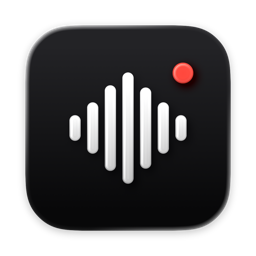
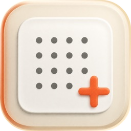
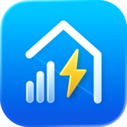
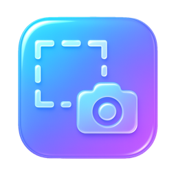

<div align="center">



# VoxFlow

**Hold Fn, speak, it types. Private dictation that runs entirely on your Mac.**

[](https://github.com/augiefra/voxflow/releases/latest)
&nbsp;
[](https://apps.apple.com/fr/developer/eric-cologni/id1853633356)


<picture>
  <source media="(prefers-color-scheme: dark)" srcset="assets/voxflow-demo-dark.gif">
  
</picture>

</div>

## Why VoxFlow

| | |
| --- | --- |
| 🔒 **Private by design** | Your voice is transcribed on your Mac. No account, no cloud, no audio or text leaves the machine. |
| ⚡ **Fast** | Text lands at your cursor about 1 second after you let go of the key (2 to 3 seconds when it needs cleaning up). |
| 🧠 **Learns your words** | Fix a name once after it's pasted, and VoxFlow remembers it next time. |
| 🎙 **Two ways to talk** | Hold Fn while you speak, or press it twice to go hands-free and once more to finish. Prefer right ⌘, ⌥ or ⌃? Pick it in Settings. |
| 🔇 **Quiet while you talk** | Music and videos are muted while you dictate, then come back. |
| 🆓 **Free** | Open source under the MIT license, signed, notarized and kept up to date automatically. |

## Install

1. [Download the latest VoxFlow DMG](https://github.com/augiefra/voxflow/releases/latest) and drag VoxFlow to Applications.
2. Open VoxFlow. A short welcome walks you through the rest, no Terminal needed:
   - the engines start downloading right away: **Full** (about 7.4 GB, with AI formatting) or **Light** (about 3.1 GB, transcription only, for 8 GB Macs or a nearly full disk);
   - allow **Microphone** and **Accessibility**;
   - choose your dictation key: **Fn** (🌐), or right **⌘**, **⌥** or **⌃**. With Fn, set **System Settings › Keyboard › Press 🌐 key to** → **Do Nothing**; the welcome checks it for you;
   - try it in the welcome window.

VoxFlow lives in the menu bar. The first launch needs an internet connection to fetch Python and its packages (about 150 MB, installed by the bundled [uv](https://docs.astral.sh/uv/)) and the models from Hugging Face. After that it works offline. Python, the engine's packages, the models and your learned words live in `~/.voxflow`; your settings (dictation key, mode) live in the app's preferences.

**Requirements:** a Mac with Apple Silicon and macOS 14 or later. Full mode needs 16 GB of memory, Light mode 8 GB. Once loaded, the models peak at about 9 GB of memory in Full mode and 5 GB in Light mode, measured on an M4 Pro with 24 GB.

## How it works

```
Fn ──► microphone ──► Voxtral Mini 4B (speech to text, streaming)
                         │
                         ▼
          Qwen2.5-Coder 7B (punctuation, hesitations, your vocabulary)
                         │
                         ▼
             pasted at your cursor ──► your corrections are learned
```

- **Voxtral Mini 4B Realtime** transcribes while you speak, so only the last half second is left to decode when you release Fn.
- **Qwen2.5-Coder 7B** cleans up hesitations and false starts. Clean sentences skip this step, which is why most dictations land in about a second. Light mode leaves Qwen out: it removes filler words and adds a capital and a final period, but doesn't fix repetitions or false starts.
- After pasting, VoxFlow watches the field for 25 seconds. When you replace a misheard word, the fix goes into a local dictionary that is fed back into the next dictations.
- Everything runs with Apple's [MLX](https://github.com/ml-explore/mlx) on the GPU of your Mac.

VoxFlow is built and tuned for **French**. Other languages are untested for now.

## Privacy

- The speech engine listens only on `127.0.0.1`, behind a random token, and refuses requests from web pages.
- Keystrokes are only observed for 25 seconds after a paste, in memory, to learn your corrections. Password fields are never read.
- The learned dictionary stays in `~/.voxflow/lexicon.db`, and you can forget any entry from the menu.
- The engine log (`~/.voxflow/daemon.log`) keeps durations and lengths, never what you dictate. Text written there by version 0.1.0 is masked, including in « Copy log ».
- Update checks fetch a signed feed from this repository. Nothing about you is sent.
- The only other downloads happen once, at first launch: Python and its packages (python-build-standalone and PyPI, via uv) and the models from Hugging Face, each file checked against its expected size and SHA-256.

## Uninstall

Quit VoxFlow from the menu bar, delete the app, then remove its data, Python and models, and its settings:

```bash
rm -rf ~/.voxflow
```

```bash
defaults delete com.ericcologni.voxflow
```

If you used version 0.1.0, VoxFlow keeps using the models it downloaded to the Hugging Face cache instead of downloading them again. Delete them only when you remove VoxFlow:

```bash
rm -rf ~/.cache/huggingface/hub/models--mlx-community--Voxtral-Mini-4B-Realtime-2602-4bit ~/.cache/huggingface/hub/models--mlx-community--Qwen2.5-Coder-7B-Instruct-4bit
```

## Build from source

```bash
git clone https://github.com/augiefra/voxflow.git
cd voxflow
macos/scripts/build_app.sh --install
```

You need a recent Xcode (VoxFlow is developed with Xcode 27). The script builds a release, downloads uv (pinned version, checksum verified), bundles it with the speech engine, the English and French strings and Sparkle, signs the app with your own developer identity and installs it in `~/Applications`. Tests: `swift test --package-path macos`, and in `daemon/`, with [uv](https://docs.astral.sh/uv/) installed (or the copy the build script downloads to `macos/.build/uv-0.12.24/uv`): `uv run --frozen python -m unittest test_inference_daemon test_model_store`.

The full technical documentation, in French, is in [docs/TECHNIQUE.md](docs/TECHNIQUE.md).

## Credits

VoxFlow stands on the work of others:

- [Voxtral Mini 4B Realtime](https://huggingface.co/mistralai/Voxtral-Mini-4B-Realtime-2602) by Mistral AI, Apache 2.0
- [Qwen2.5-Coder-7B-Instruct](https://huggingface.co/Qwen/Qwen2.5-Coder-7B-Instruct) by the Qwen team at Alibaba Cloud, Apache 2.0
- [MLX](https://github.com/ml-explore/mlx), [mlx-audio](https://github.com/Blaizzy/mlx-audio) and [mlx-lm](https://github.com/ml-explore/mlx-lm), MIT, with 4-bit conversions by [mlx-community](https://huggingface.co/mlx-community)
- [uv](https://github.com/astral-sh/uv) by Astral, bundled to install Python and the engine's packages, MIT or Apache 2.0
- [Sparkle](https://sparkle-project.org) for updates, MIT

Every third-party license is listed in [THIRD_PARTY_NOTICES.txt](macos/Resources/THIRD_PARTY_NOTICES.txt) and in the app menu.

## En français

VoxFlow est une dictée vocale gratuite et 100 % locale pour Mac. Maintiens **Fn** (ou ⌘, ⌥, ⌃ de droite) pour dicter, ou appuie deux fois pour parler mains libres : le texte est transcrit par Voxtral, mis en forme par Qwen, puis collé au curseur, en environ une seconde. VoxFlow apprend ton vocabulaire à partir de tes corrections, et rien ne quitte ton Mac. L'interface est en français et en anglais, et un court accueil installe tout sans Terminal : moteurs complets (7,4 Go) ou légers (3,1 Go), autorisations, choix de la touche. [Télécharger la dernière version](https://github.com/augiefra/voxflow/releases/latest) · [Documentation technique](docs/TECHNIQUE.md)

## More apps by Eric

I'm an indie developer in France. If VoxFlow saves you time, the nicest thank-you is to try one of my apps.

<table>
<tr>
<td align="center" width="33%">
<a href="https://apps.apple.com/fr/app/facilabo-de-230-calendriers/id6756318719"></a><br>
<b>FacilAbo</b><br>
<sub>230+ calendars to subscribe to on iPhone: holidays, school breaks, tax deadlines, sports.</sub><br>
<sub>★ 4.9 · iPhone</sub>
</td>
<td align="center" width="33%">
<a href="https://apps.apple.com/fr/app/eurovolt-conso-%C3%A9lectricit%C3%A9/id6761270150"></a><br>
<b>EuroVolt</b><br>
<sub>Your Linky meter in euros, day by day, with home-screen widgets.</sub><br>
<sub>iPhone · France</sub>
</td>
<td align="center" width="33%">
<a href="https://apps.apple.com/fr/app/pastscreen/id6755425479"></a><br>
<b>PastScreen</b><br>
<sub>Ultra-fast, clipboard-first screenshots for developers.</sub><br>
<sub>Mac</sub>
</td>
</tr>
</table>

<div align="center">

[**See all my apps on the App Store →**](https://apps.apple.com/fr/developer/eric-cologni/id1853633356)

<sub>VoxFlow · MIT License · © 2026 Eric Cologni</sub>

</div>
