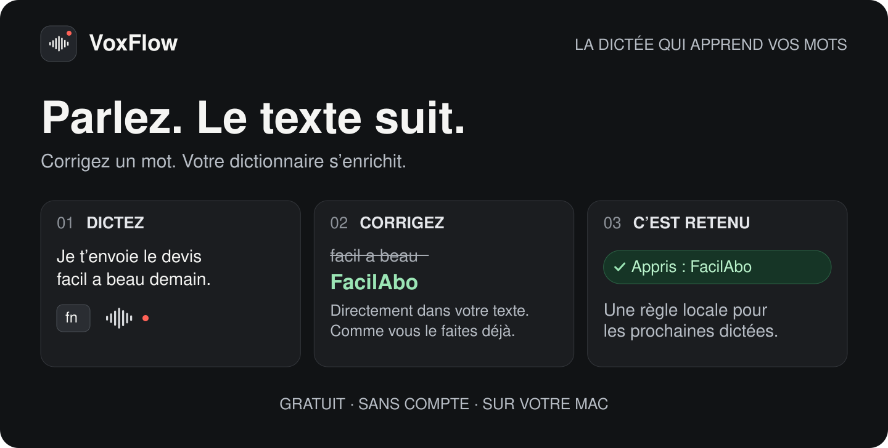
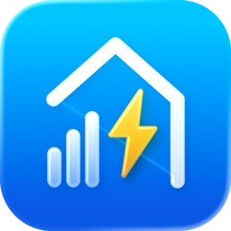

**Français** · [English](README.en.md)

<picture>
  <source media="(max-width: 767px)" srcset="assets/voxflow-hero-fr-mobile.svg">
  
</picture>

**Gratuit. Sans compte. Votre voix reste sur votre Mac.**

Apple Silicon · macOS 14 ou plus · Dictée pensée pour le français

[Le dictionnaire qui apprend](#vous-corrigez-voxflow-apprend) · [Installation](#prêt-en-quelques-gestes) · [Dernière version](https://github.com/augiefra/voxflow/releases/latest)

## Une touche. Votre voix. C’est écrit.

**VoxFlow transforme votre voix en texte, là où vous écrivez.** Un message, un mail, une note : placez le curseur dans votre champ de texte et laissez vos idées avancer.

1. **Maintenez Fn** et parlez naturellement.
2. **Relâchez la touche.** VoxFlow termine la transcription et insère votre texte au curseur.
3. **Continuez votre travail.** Si un nom est mal orthographié, corrigez-le directement dans le texte : VoxFlow peut en faire une règle pour la suite.

<picture>
  <source media="(prefers-color-scheme: dark)" srcset="assets/voxflow-demo-dark.gif">
  
</picture>

Une petite pilule suit l’écoute, puis confirme les corrections apprises.

Envie de parler plus longtemps ? **Appuyez deux fois sur Fn pour dicter mains libres**, puis une fois pour terminer. Vous pouvez aussi choisir la touche **⌘, ⌥ ou ⌃ de droite** dans les réglages.

## Vous corrigez. VoxFlow apprend.

Les noms de vos projets, de vos clients et de vos produits méritent leur bonne orthographe. **Le dictionnaire s’enrichit automatiquement à partir de vos corrections après la dictée.**

Par exemple, dans une phrase :

| VoxFlow a écrit | Vous corrigez dans votre texte |
| --- | --- |
| Je t’envoie le devis **facil a beau** demain. | Je t’envoie le devis **FacilAbo** demain. |

Corrigez la graphie dans les secondes qui suivent, comme vous le feriez normalement. Lorsque la correction est retenue, une **confirmation verte « Appris : FacilAbo »** apparaît. La règle enregistrée aide VoxFlow à rétablir cette graphie lors des prochaines dictées.

**Pas besoin de remplir une liste de mots à l’avance.** Retrouvez les corrections enregistrées dans **« Lexique appris »**, et oubliez celles dont vous ne voulez plus.

<strong>Quelles corrections sont apprises ?</strong>

VoxFlow suit le champ pendant **25 secondes maximum après l’insertion du texte**. Cette observation s’arrête aussi à l’envoi, au changement de champ ou au début d’une nouvelle dictée. Dans certains champs sans accès au texte, un clic ou une modification impossible à suivre peut interrompre l’apprentissage.

Les corrections retenues sont des substitutions courtes et plausibles de vocabulaire. Une phrase largement réécrite, une correction purement grammaticale ou le remplacement de presque tout un titre court peuvent être ignorés. La confirmation verte et le menu **« Lexique appris »** permettent de vérifier ce qui a été enregistré.

Le dictionnaire corrige la transcription au moment du nettoyage ; il ne réentraîne pas le modèle vocal. Certaines variantes ambiguës bénéficient du nettoyage du mode Complet. Les champs de mot de passe ne sont pas suivis.

## Discret pendant l’écoute. Utile tous les jours.

| | Ce que ça change pour vous |
| --- | --- |
| **Votre voix reste privée** | La transcription et le nettoyage tournent sur votre Mac. Aucun audio ni texte dicté n’est envoyé à un service cloud. |
| **Un démarrage guidé** | L’accueil prépare les moteurs, explique les autorisations et vous fait essayer la dictée. Aucune commande à saisir. |
| **Un texte prêt à reprendre** | Les hésitations simples sont retirées ; le mode Complet peut aussi nettoyer les reprises et la ponctuation quand c’est utile. |
| **Une place dans la barre des menus** | VoxFlow reste à portée de touche et met temporairement le son du Mac en sourdine pendant l’écoute. |
| **Une seconde chance pour vos textes** | Les cinq dernières dictées restent disponibles en mémoire dans le menu pour les coller à nouveau. |
| **Gratuit, et ouvert** | Aucun abonnement. Le code est ouvert sous licence MIT, l’app est signée et notarisée par Apple, les mises à jour passent par Sparkle. |

## Prêt en quelques gestes

1. **[Téléchargez VoxFlow](https://github.com/augiefra/voxflow/releases/latest)** et glissez l’application dans **Applications**.
2. **Ouvrez-la et suivez l’accueil.** Il télécharge les modèles et vous guide pour autoriser le microphone et l’accessibilité.
3. **Essayez votre première dictée.** Maintenez Fn, parlez, relâchez. C’est tout.

Le premier lancement nécessite Internet pour préparer les moteurs. **La dictée fonctionne ensuite hors ligne.** L’interface est disponible en français et en anglais ; la reconnaissance et le nettoyage sont actuellement réglés pour le français.

<strong>Quel Mac, quel mode et quelle place prévoir ?</strong>

VoxFlow nécessite un **Mac avec Apple Silicon** et **macOS 14 ou plus**.

| Mode | Pour quel usage ? | Seuil de mémoire de l’app | Modèles à télécharger |
| --- | --- | --- | --- |
| **Léger** | Transcription et corrections locales, sans le modèle de nettoyage | 8 Go | Environ 2,51 Go |
| **Complet** | Avec le nettoyage contextuel de Qwen3.5 | 16 Go | Environ 5,57 Go au total |

Les seuils de mémoire sont ceux appliqués par l’app, pas une mesure du pic d’utilisation. Python et ses paquets sont aussi installés automatiquement au premier lancement, pour environ 150 Mo supplémentaires. Les anciens modèles restent sur le disque lors d’une mise à jour.

Pour Fn, choisissez **Réglages Système → Clavier → Appuyer sur 🌐 → Ne rien faire**. L’accueil vérifie ce réglage. L’application se relance une fois l’accessibilité accordée pour activer la touche.

<strong>Et les performances ?</strong>

VoxFlow utilise Parakeet pour transcrire et Qwen3.5 pour nettoyer les passages qui le nécessitent en mode Complet.

Sur 30 phrases françaises synthétiques, mesurées sur un M4 Pro avec 24 Go, le délai médian du moteur après relâchement est passé de **1,34 s à 0,19 s** avec la version 0.1.6, avant le collage. La version 0.1.7 corrige aussi l’attente inutile après un appui bref sans parole.

Ces chiffres ne prédisent pas toutes les voix, les bruits ou les Mac. Retrouvez les conditions d’essai et les limites dans les **[mesures détaillées](docs/PERFORMANCE.md)**.

<strong>Où sont mes données ?</strong>

- Les modèles, Python et le dictionnaire restent dans `~/.voxflow`. Les réglages de l’app sont dans les préférences macOS.
- Les corrections sont suivies temporairement et en mémoire ; les champs sécurisés sont exclus. Le dictionnaire est stocké dans `~/.voxflow/lexicon.db` et ses entrées peuvent être oubliées depuis le menu.
- Les cinq dernières dictées restent en mémoire, sans historique de dictée enregistré sur disque.
- Le journal du moteur conserve par défaut les durées et longueurs, pas le contenu dicté. Les anciens textes journalisés par la version 0.1.0 sont masqués.
- Le moteur n’écoute que sur l’interface locale, avec un jeton aléatoire, et refuse les requêtes des pages web.
- Les téléchargements initiaux et les vérifications de mises à jour utilisent Internet. La transcription et le nettoyage de vos dictées restent locaux.

## Pour aller plus loin

[Documentation technique](docs/TECHNIQUE.md) · [Mesures de performance](docs/PERFORMANCE.md) · [Versions et mises à jour](https://github.com/augiefra/voxflow/releases) · [Signaler un problème](https://github.com/augiefra/voxflow/issues)

<strong>Compiler, tester ou désinstaller</strong>

Les commandes de compilation, de test et de désinstallation sont conservées dans le **[guide en anglais](README.en.md#development-and-maintenance)**. La **[documentation technique](docs/TECHNIQUE.md)** détaille l’architecture en français.

Les visuels de cette page se régénèrent avec `python3 assets/make_readme_assets.py`, sans dépendance supplémentaire.

<strong>Crédits et logiciels libres</strong>

VoxFlow s’appuie sur le travail de :

- **[Parakeet TDT 0.6B v3](https://huggingface.co/nvidia/parakeet-tdt-0.6b-v3)**, par NVIDIA, converti pour MLX par [mlx-community](https://huggingface.co/mlx-community/parakeet-tdt-0.6b-v3/tree/ed2b7e8c15f9aaa0b5772e2efb986255eaef7e15), CC BY 4.0.
- **[Qwen3.5-4B](https://huggingface.co/Qwen/Qwen3.5-4B)**, par l’équipe Qwen d’Alibaba Cloud, Apache 2.0.
- [Whisper large-v3-turbo](https://huggingface.co/openai/whisper-large-v3-turbo), MIT, et [Voxtral Mini 4B Realtime](https://huggingface.co/mistralai/Voxtral-Mini-4B-Realtime-2602), Apache 2.0, disponibles comme moteurs optionnels via `--asr-model`.
- [MLX](https://github.com/ml-explore/mlx), [mlx-audio](https://github.com/Blaizzy/mlx-audio) et [mlx-lm](https://github.com/ml-explore/mlx-lm), MIT, avec des conversions de [mlx-community](https://huggingface.co/mlx-community).
- [uv](https://github.com/astral-sh/uv), par Astral, MIT ou Apache 2.0, et [Sparkle](https://sparkle-project.org), MIT.

Les licences sont regroupées dans [THIRD_PARTY_NOTICES.txt](macos/Resources/THIRD_PARTY_NOTICES.txt), également accessible depuis le menu de l’app. Le code de VoxFlow est sous [licence MIT](LICENSE).

## Un projet indépendant, fait en France

Je suis **Eric Cologni**, développeur indépendant. Si VoxFlow vous rend service, **[une étoile sur GitHub](https://github.com/augiefra/voxflow/stargazers)** aide à le faire découvrir. Vous pouvez aussi jeter un œil à mes autres apps :

<table>
<tr>
<td align="center" width="50%"><a href="https://apps.apple.com/fr/app/facilabo-de-230-calendriers/id6756318719"> <strong>FacilAbo</strong></a> Vos calendriers sur iPhone.</td>
<td align="center" width="50%"><a href="https://apps.apple.com/fr/app/eurovolt-conso-%C3%A9lectricit%C3%A9/id6761270150"> <strong>EuroVolt</strong></a> Votre consommation électrique.</td>
</tr>
</table>

[**Télécharger VoxFlow →**](https://github.com/augiefra/voxflow/releases/latest)

VoxFlow · Gratuit et open source · © 2026 Eric Cologni

